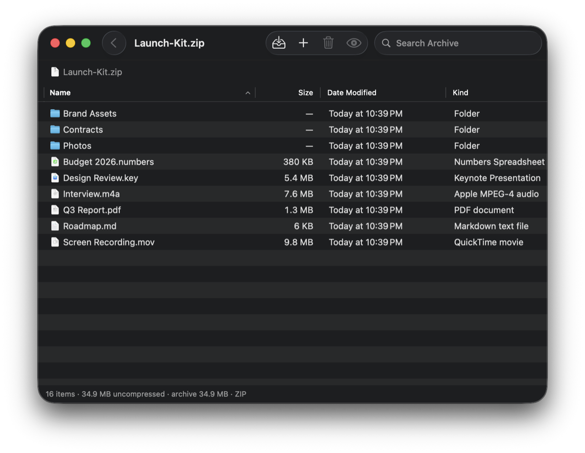
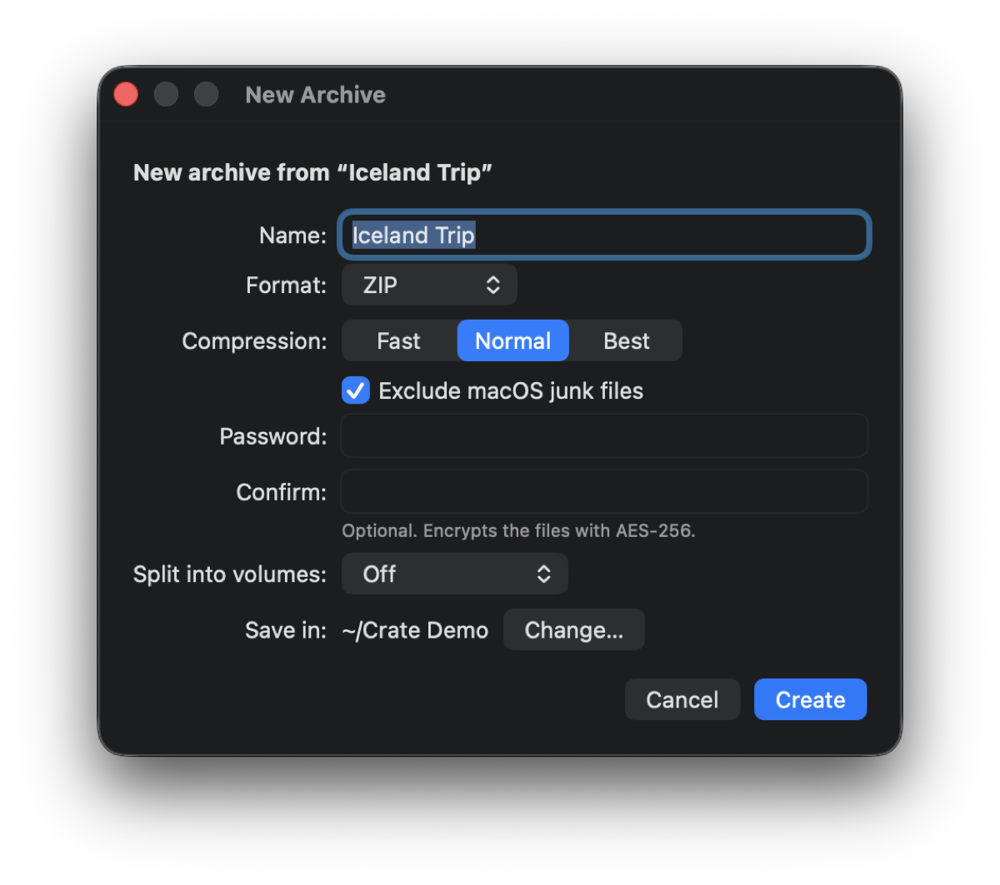
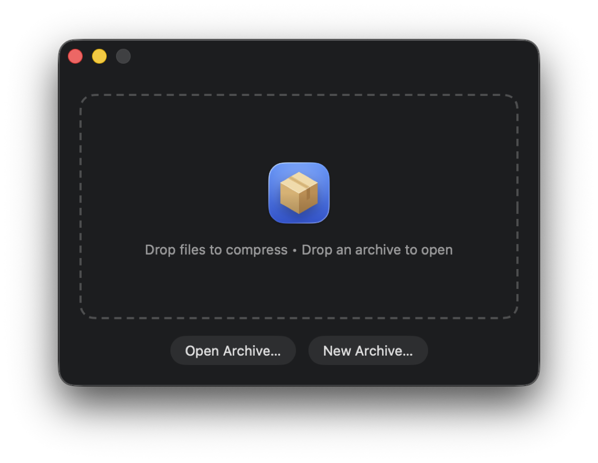

<p align="center">
  
</p>

<h1 align="center">Crate</h1>

<p align="center">
  <b>The free, open-source archive utility macOS should have shipped with.</b><br>
  Browse, Quick Look, extract and create ZIP, 7-Zip, RAR, TAR and more: in a native Mac app of about 3 MB.
</p>

<p align="center">
  <a href="https://github.com/kleash/crate/releases/latest"></a>
  <a href="https://github.com/kleash/crate/actions/workflows/build.yml"></a>
  
  
  <a href="LICENSE"></a>
</p>

<p align="center">
  
</p>

Double-clicking a .zip in Finder dumps it into a folder and leaves you to clean up. Crate opens it in a window
instead, like a folder: look inside, preview files with Space, drag out only what you need. It's free and has no
ads, accounts, telemetry or third-party dependencies (it uses the libarchive that ships with macOS).

## Install

**Homebrew**

```sh
brew install kleash/tap/crate
```

**Download**: get `Crate-<version>.zip` from the [latest release](https://github.com/kleash/crate/releases/latest),
unzip it and move Crate.app to Applications. It's signed and notarized by Apple, so it opens like any other app.

## Features

- **Open** ZIP, 7-Zip, RAR/RAR5, TAR, TAR.GZ/.BZ2/.XZ, single-file .gz/.bz2/.xz, ISO, CPIO and XAR/PKG, and split
  archives (name.zip.001, name.zip.002, …: open the .001).
- **Look inside files that are archives in disguise**: Office (.docx, .xlsx, .pptx), OpenDocument, Pages, Keynote
  and Numbers files, EPUB books, iOS (.ipa) and Android (.apk, .aab, .aar) apps, Java .jar, Python wheels, NuGet,
  VS Code (.vsix) and browser extensions, and comic books (.cbz, .cbr, .cb7).
- **Browse** one window per archive: folders, path bar, sortable columns, search across the whole archive,
  Quick Look preview with Space, and a right-click menu (Open, Open in Default App, Quick Look, Extract…, Delete).
  ⌘↓ opens a file in its own app, from a read-only temporary copy.
- **Extract** the selection or everything, or use **Extract Here**, which adds no extra folder when the archive
  has a single top-level item. You can also drag items out to Finder.
- **Create** ZIP, 7-Zip, TAR, TAR.GZ, TAR.XZ or TAR.BZ2 archives: drop files on Crate, choose File ▸ New Archive…,
  or use Compress with Crate in Finder. The New Archive window sets the format, compression, an AES-256 password
  (ZIP only), splitting into volumes and where to save. macOS junk files (.DS_Store, `._*`, `__MACOSX`) are left out.
- **Split into volumes** of 10 MB, 100 MB, 700 MB (CD), 1 GB, 4 GB (FAT32) or a custom size (MB of 1,048,576 bytes,
  as in 7-Zip): name.zip.001, name.zip.002, … They are plain pieces of one archive: 7-Zip and Keka open the .001
  directly, and anywhere else `cat name.zip.[0-9][0-9][0-9] > name.zip` joins them back into an ordinary archive.
- **Edit** ZIP, 7-Zip and TAR archives: drop files on an open archive to add them, press Delete to remove items.
- **Finder integration**
  - Open With ▸ Crate.
  - Right-click ▸ Services ▸ **Compress with Crate** (opens the New Archive window); on archives, .001 volumes
    included, also **Open with Crate** and **Extract Here with Crate** (with progress and Cancel).
  - Quick Look: press Space on an archive in Finder to see the files inside, without opening anything.
- **Safe extraction**: nothing in an archive can write outside the folder you extract to (`../` paths are refused;
  absolute paths, symlinks and hard links stay inside).

<p align="center">
  
  
</p>

To make Crate open archives when you double-click them: select a .zip in Finder, File ▸ Get Info, Open with:
Crate, **Change All…**

## Build from source

Needs macOS 13.1 or later and the Command Line Tools with Swift 5.9 or later (`xcode-select --install`). Xcode is not
needed.

```sh
git clone https://github.com/kleash/crate.git && cd crate
./build.sh      # universal app in build/Crate.app (./build.sh --native builds only this Mac's architecture, faster)
./install.sh    # copies it to ~/Applications and registers Open With, the Services and Quick Look
```

`./install.sh --dry-run` prints what it would do. No administrator rights are needed. `./uninstall.sh` removes it
again. A build of your own is signed ad hoc, which is enough on the Mac that built it.

Releases: bump `VERSION`, commit, then `scripts/release.sh` signs with a Developer ID, notarizes and publishes the
GitHub release; the build workflow then updates the Homebrew cask.

The tests (`./test.sh`) need Swift 6 or later.

## Known limitations

- Encrypted 7-Zip and RAR archives can be browsed (unless their file names are encrypted too) but not extracted,
  because the libarchive in macOS can't decrypt them. Encrypted ZIPs work.
- `.tar.zst`, `.lz4` and similar archives need command-line tools that macOS doesn't include, so Crate can't open them.
- Adding or deleting items rewrites the whole archive at Normal compression. An encrypted ZIP is re-encrypted
  with AES-256.
- There is no per-file packed size (libarchive doesn't report one). The status bar shows the archive's size.
- RAR, ISO, CPIO, XAR/PKG, single-file .gz/.bz2/.xz and split archives are read-only.
- Disk images (.dmg) aren't archives that libarchive can read; double-click them to mount them in Finder instead.
  App bundles (.app) are folders: right-click ▸ Show Package Contents in Finder.
- Quick Look doesn't preview split archives: its sandbox lets it read only the selected .001, not the other volumes.
- A single .bz2 or .xz file doesn't record its uncompressed size, so Crate shows it as Zero KB.

## Contributing

Bug reports and pull requests are welcome. The code is small, about 2,600 lines of Swift:

- `Sources/ArchiveCore`: listing, extracting, writing and splitting archives on top of libarchive (tested).
- `Sources/Crate`: the AppKit app.
- `Sources/CrateQuickLook`: the Quick Look extension.

Run `./test.sh` before sending a pull request.

## License

[MIT](LICENSE)
